<div align="center">


# Nothiz Product Desk

**From product sourcing to listing details, in one desktop app.**<br />
Alibaba.com sourcing · product image collection with sharpness checks · bilingual (Chinese and English) titles and descriptions in bulk

[](https://github.com/NothiZ/Product-Details-Generation-2.0/releases)
[](#run-from-source)
[](#details)
[](LICENSE)

[简体中文](README.md) · **English**

[**Download for Windows**](https://github.com/NothiZ/Product-Details-Generation-2.0/releases/download/v2.1.0/Nothiz.Product.Desk-win-x64.zip) ·
[Quick start](#quick-start) ·
[Workflow](#workflow) ·
[Supported platforms](#supported-platforms) ·
[Run from source](#run-from-source)

<br />

<table>
  <tr>
    <td align="center"><a href="assets/screenshots/search-complete.png">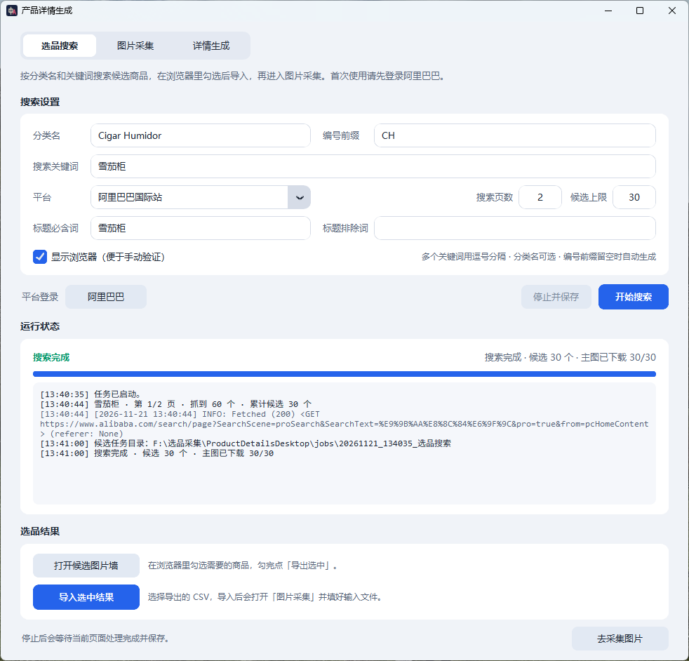</a></td>
    <td align="center"><a href="assets/screenshots/image-collection-complete.png">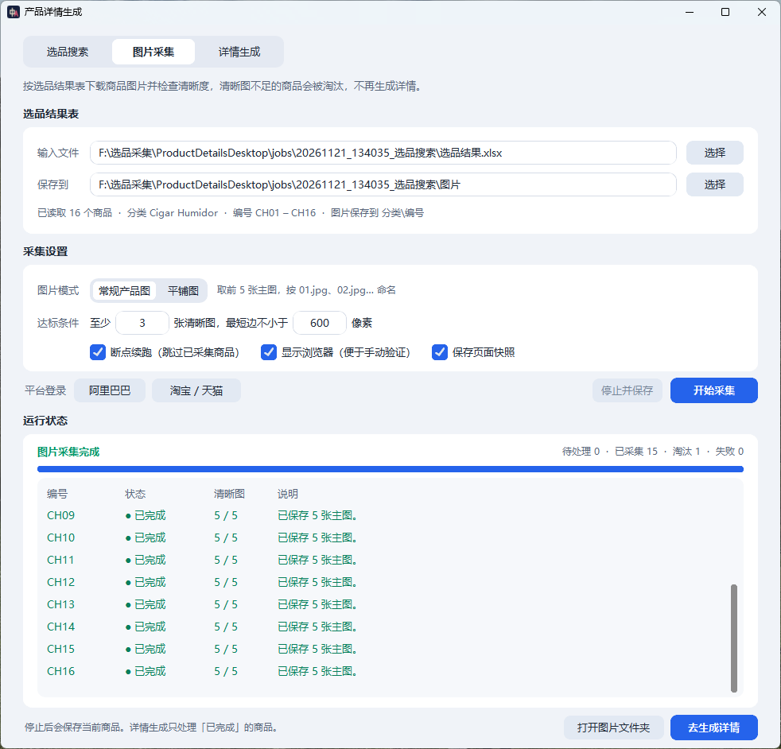</a></td>
    <td align="center"><a href="assets/screenshots/details-complete.png">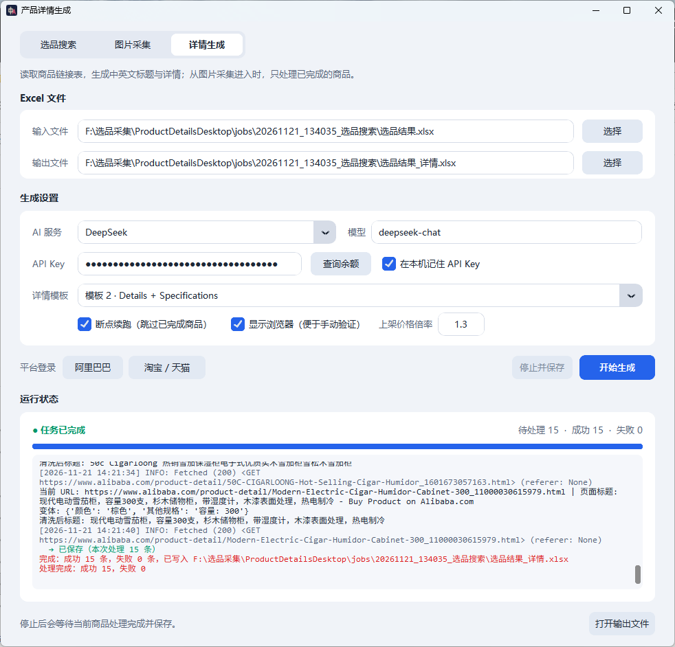</a></td>
  </tr>
  <tr>
    <td align="center"><sub><b>① Product search</b></sub></td>
    <td align="center"><sub><b>② Image collection</b></sub></td>
    <td align="center"><sub><b>③ Details generation</b></sub></td>
  </tr>
</table>

<sub>Click a screenshot to view it full size. The app interface is in Chinese.</sub>

</div>

<br />

## What it does

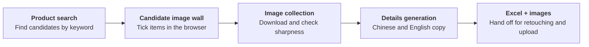

| | |
| --- | --- |
| **Product search** | Searches Alibaba.com by keyword, downloads main images with a sharpness label, and builds a candidate image wall that opens offline. Tick items in the browser, export, then import back into the app. |
| **Image collection** | Saves images under "category / product code" and checks resolution and sharpness. Products without enough clear images are marked as rejected and do not move on to details generation. |
| **Details generation** | Writes Chinese and English titles and descriptions, color and size specs, and a listing price calculated with a multiplier, all into Excel. |

**Also worth knowing**

- **One code, end to end**: the product code assigned on import names the image folder and appears in the details sheet, so everything lines up by code.
- **Stop any time, resume later**: "Stop and save" finishes the current product, saves, and lets you continue next time.
- **Content flags**: the "needs review" column in the details sheet lists matched flagged words, and the "failure reason" column records real failures, for manual review.
- **Self-contained**: the release includes Python, dependencies and Chromium, so nothing else needs to be installed.

<a name="quick-start"></a>

## Quick start

1. Download the Windows archive for your version from [Releases](https://github.com/NothiZ/Product-Details-Generation-2.0/releases). The current build is named `Nothiz Product Desk-win-x64.zip`.
2. Extract the whole archive and run `Nothiz Product Desk.exe`. Keep the `_internal` folder next to it. On first launch, choose where to store app data.
3. To source from Alibaba.com, log in under "Product search" first, then follow the workflow below. If you already have a sheet of product links, you can open "Details generation" directly.
4. For details generation, enter your DeepSeek or Gemini API key, choose a model and template, then click "Start generation" (开始生成).

> [!NOTE]
> Collection and details generation need an internet connection. AI usage is billed to your account with the provider you choose. For more on the desktop app, see the [usage notes](DESKTOP_USAGE.txt) (Chinese).

<a name="workflow"></a>

## Workflow

The screenshots show a cigar-cabinet job as an example: **30 candidates** found, **16 products** selected, and **15 products** passed the image check and got details.

### 1. Product search

- Enter keywords. You can also set a category name, a code prefix, the number of search pages, a candidate limit, and title filter words. When the candidate limit or the last page is reached, the app saves the candidates found so far.
- When the search finishes, click "Open candidate image wall". In the browser you can see the local main images with sharpness labels, open a larger view, and tick items across pages.
- Click "Export selected" to download a CSV, then go back to the desktop app and click "Import selected results". The app checks product IDs and links against the current candidates, assigns product codes, and creates this job's `选品结果.xlsx`. The rest of the workflow uses this job sheet.

<p align="center">
  <a href="assets/screenshots/candidate-wall.png">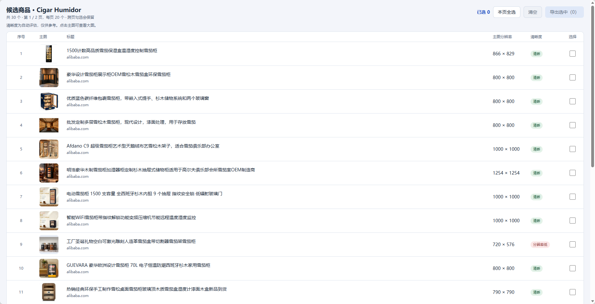</a>
</p>
<p align="center"><sub>The image wall opens offline. Sharpness labels are there to help manual selection.</sub></p>

<details>
<summary>Search and main-image download progress</summary>

<p align="center">
  <a href="assets/screenshots/search-running.png">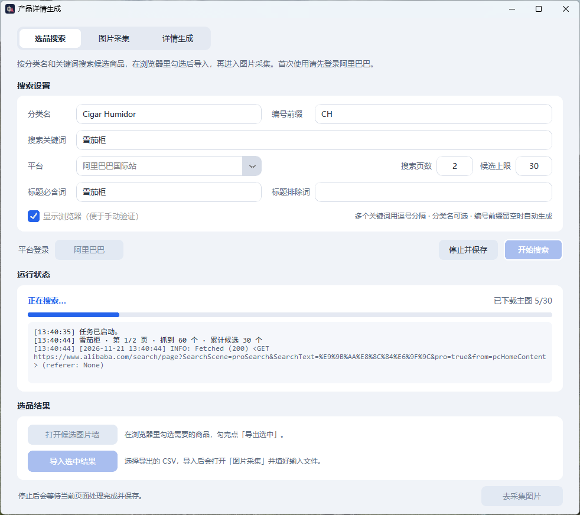</a>
</p>

</details>

### 2. Image collection

After the import, the app opens "Image collection" with this job's sheet loaded. Choose an image mode, confirm the sharpness threshold and the save folder, then click "Start collection".

| Image mode | What is collected | Default pass condition |
| --- | --- | --- |
| Regular product images | The first 5 main images | At least 4 clear images, shortest side no less than 600 px |
| Flat-lay images | Up to 8 candidate images, for manual picking | At least 2 clear images, shortest side no less than 600 px |

The app checks resolution and sharpness. Whether the image content is right still needs a human check. Images are saved by "category / product code", named `01.jpg`, `02.jpg` and so on. A product that fails the check but has saved images gets `-跳过` ("skipped") added to its folder name, for example `CH01-跳过`.

Collection status and clear-image counts are written back to the job sheet. If you change the number of clear images or the shortest side, a resumed run re-evaluates against the new rule. When you use a different save location, pick an empty folder for this job.

<details>
<summary>Ready state, running state, and the image folders</summary>

<p align="center">
  <a href="assets/screenshots/image-collection-ready.png">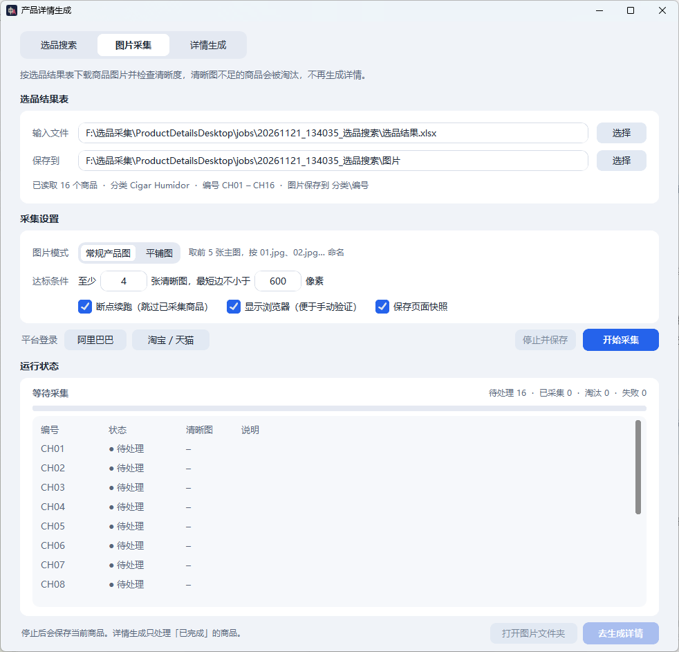</a>
  <a href="assets/screenshots/image-collection-running.png">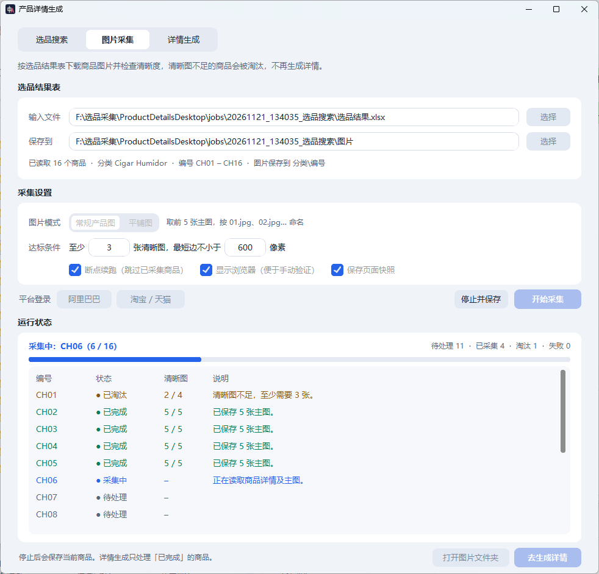</a>
</p>
<p align="center"><sub>Left: settings before collection. Right: per-product results while it runs.</sub></p>

<p align="center">
  <a href="assets/screenshots/image-output-folders.png">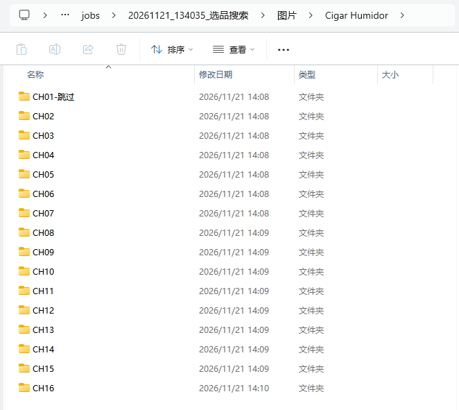</a>
</p>
<p align="center"><sub>Folders follow the product code. A folder that failed the check but has images carries the "skipped" marker.</sub></p>

</details>

<a name="details"></a>

### 3. Details generation

On the image collection page, click "Go to details generation" (去生成详情). The app processes only products marked as completed, and keeps the product codes from the job sheet. You can also import your own `.xlsx` link sheet; the first row should use the column name `链接` ("link"), with one product detail page link per row.

Choose the AI service, model and template, then click "Start generation". The output goes to the same folder as the input by default, with `_详情.xlsx` added to the file name. Click "Choose folder" to change it. If a file with the same name belongs to another job, the app asks you to pick another folder.

| Setting or field | Notes |
| --- | --- |
| Details template | Template 1 uses a Key: Value list. Template 2 is split into Details and Specifications. |
| Collected price and listing price | The listing price defaults to **1.25 ×** the collected price, and the multiplier can be changed. Both ends of a price range are calculated separately. |
| Specs and bilingual copy | Outputs color, size and other specs, plus Chinese and English titles and descriptions. |
| Needs review and failure reason | The review column marks matched flagged words for manual checking. The failure-reason column records collection, API or missing-copy problems. |

<p align="center">
  <a href="assets/screenshots/details-excel.png">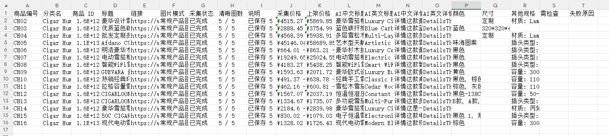</a>
</p>
<p align="center"><sub>The details sheet keeps the original product codes, so you can find the matching images by code. In this example CH01 did not pass, so the sheet starts at CH02.</sub></p>

<details>
<summary>The details generation screen while running</summary>

<p align="center">
  <a href="assets/screenshots/details-running.png">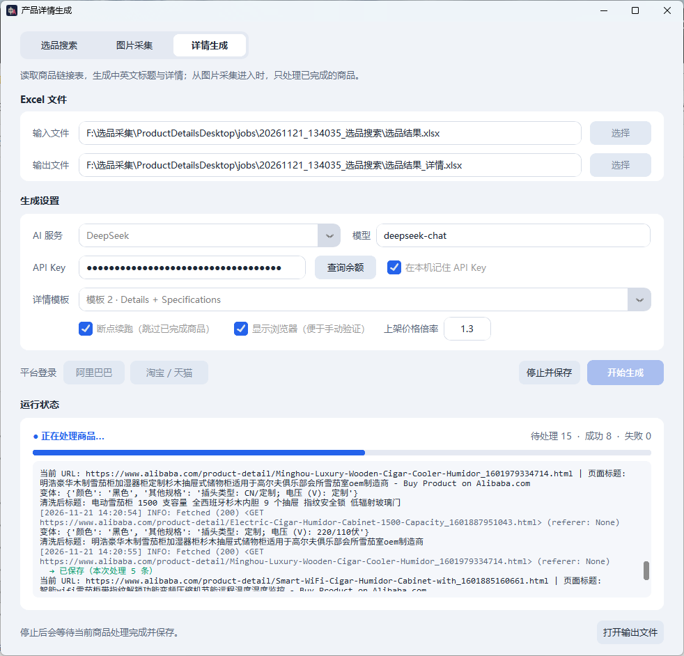</a>
</p>

</details>

<a name="supported-platforms"></a>

## Supported platforms

| Platform | Product search | Image collection | Details generation |
| --- | :---: | :---: | :---: |
| Alibaba.com | ✅ | ✅ | ✅ |
| Taobao | — | — | ✅ |
| Tmall | — | — | ✅ |

Details generation takes full product detail links under `alibaba.com`, `taobao.com` or `tmall.com` (including subdomains). Product specs follow the options listed on the page, and real stock is whatever the platform shows.

Taobao and Tmall share one login flow. If a verification code is needed, keep "Show browser" on, complete the check, then return to the app and click "Continue".

## Where files are saved

After you pick a parent folder on first launch, the app creates `ProductDetailsDesktop` inside it. Each sourcing batch gets its own job folder and its own numbering. With default paths, the main files of one complete job look like this.

```text
ProductDetailsDesktop/
└─ jobs/
   └─ <job time>_选品搜索/
      ├─ candidates.html          candidate image wall
      ├─ candidates/              candidate main images
      ├─ 选品结果.xlsx             selection record and image collection status
      ├─ 图片/                    saved by category and product code
      └─ 选品结果_详情.xlsx        generated bilingual details sheet
```

- **Resume and stop**　Details generation reuses finished copy by product link. After "Stop and save", the app finishes the current item and saves what is done.
- **Output file in use**　On the final save, the app tries a free `_backup.xlsx` or a numbered backup name, and shows where it actually saved.

## Privacy and security

> [!WARNING]
> If you tick "Remember API key on this computer", the key is stored in **plain text** in the local `settings.json`. Remove these files and values before sharing the data folder or screenshots.

- Login state and settings are kept in the data root. The release does not contain the developer's API keys, login state or real product sheets.
- When generating details, product information is sent to the AI service you choose (DeepSeek or Gemini).
- Please follow each platform's terms of service and access limits, and keep search pages and collection volume reasonable.

## FAQ

<details>
<summary>Why are there fewer results than the pages or candidate limit I set?</summary>

Pages and candidate count are upper limits. When the last page is reached, the app saves whatever it found, and title filtering and de-duplication also affect the final number.

</details>

<details>
<summary>What should I check if the CSV import fails?</summary>

Use the CSV exported from the image wall that is currently open. The app checks that product IDs and links appear in the current candidates. Once the import is confirmed, you only need to keep the Excel files in the job folder.

</details>

<details>
<summary>Why is the download several hundred MB?</summary>

The release includes the Python runtime, the app's dependencies and Chromium. After extraction, the whole folder runs on a compatible Windows computer.

</details>

<a name="run-from-source"></a>

## Run from source

Windows 64-bit and Python 3.12 are recommended. Open PowerShell in the project folder.

```powershell
python -m venv venv
.\venv\Scripts\python.exe -m pip install -r requirements.txt
$env:PLAYWRIGHT_SKIP_BROWSER_GC = "1"
.\venv\Scripts\python.exe -m patchright install chromium
.\venv\Scripts\python.exe desktop_app.py
```

<details>
<summary>Command-line usage</summary>

For details generation, copy [`.env.example`](.env.example) to `.env` and fill in your API key, then set the input sheet, output sheet, provider and template at the top of `run.py`. The default input is `products.xlsx` and the default output is `products_output.xlsx`.

```powershell
.\venv\Scripts\python.exe login.py alibaba
.\venv\Scripts\python.exe run.py
.\venv\Scripts\python.exe image_collection.py --help
```

For Taobao or Tmall, use `login.py taobao`. The image collection command takes the job selection sheet and an image save folder; run it with `--help` for more options.

</details>

<details>
<summary>Windows packaging and offline tests</summary>

```powershell
.\venv\Scripts\python.exe -m pip install -r requirements-build.txt
.\build_desktop.ps1
.\venv\Scripts\python.exe -B -m unittest discover -s tests -v
```

The default build goes to `dist/`. Use `-OutputRoot` to choose another build folder inside the project, and `-SkipZip` to produce only the program folder. The regression tests use local samples and mocked APIs. Packaging notes are in the [developer docs](docs/dev/README.md) (Chinese).

</details>

## License

The project code is licensed under GPL-3.0-only. Third-party dependencies keep their own license terms. See [LICENSE](LICENSE).

<div align="center">
<sub><a href="README.md">简体中文</a> · <b>English</b></sub>
</div>
