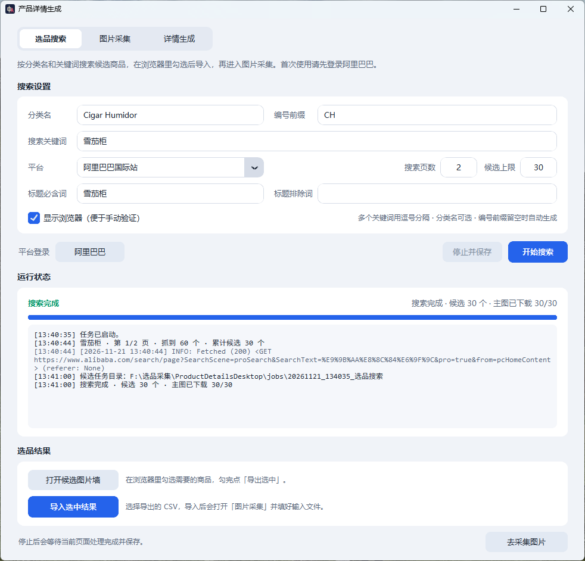
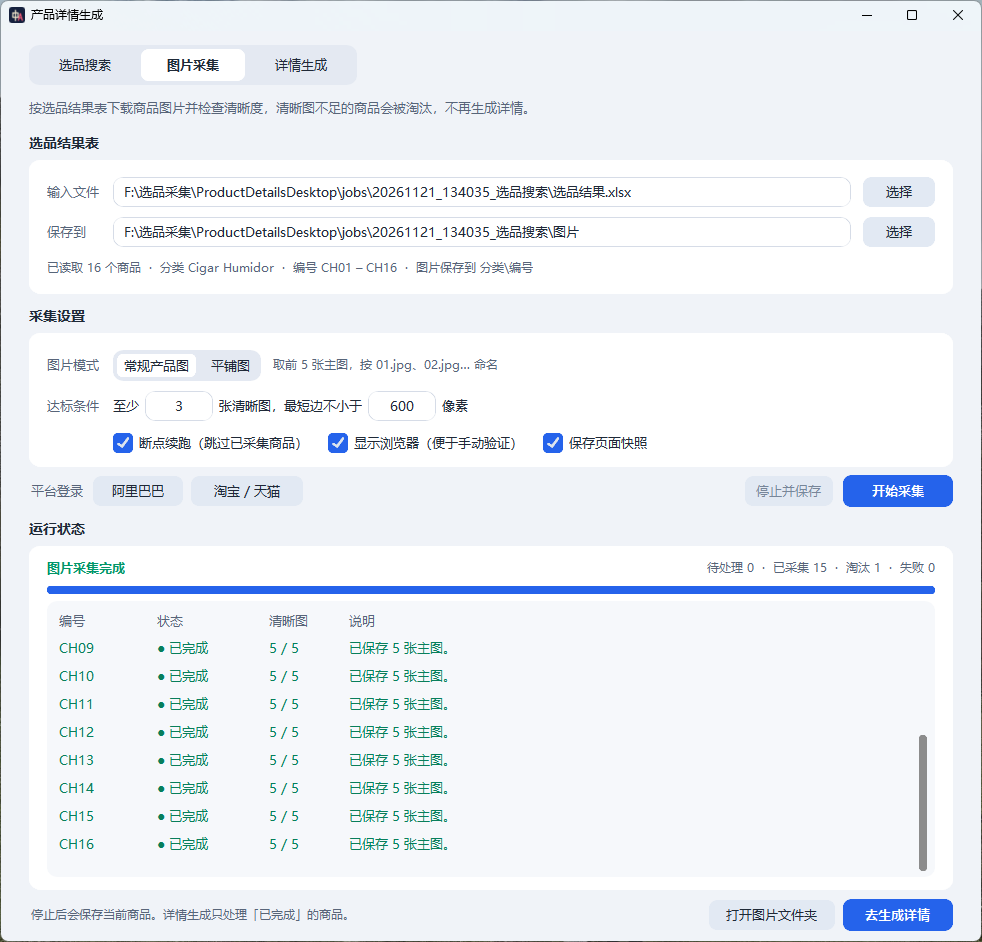
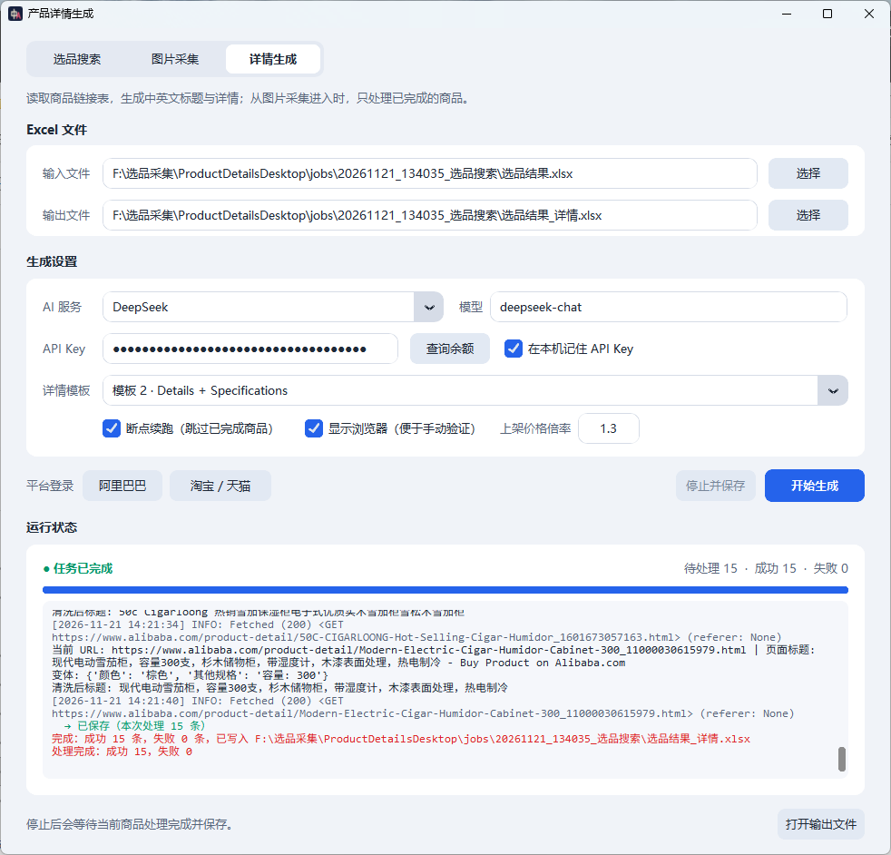
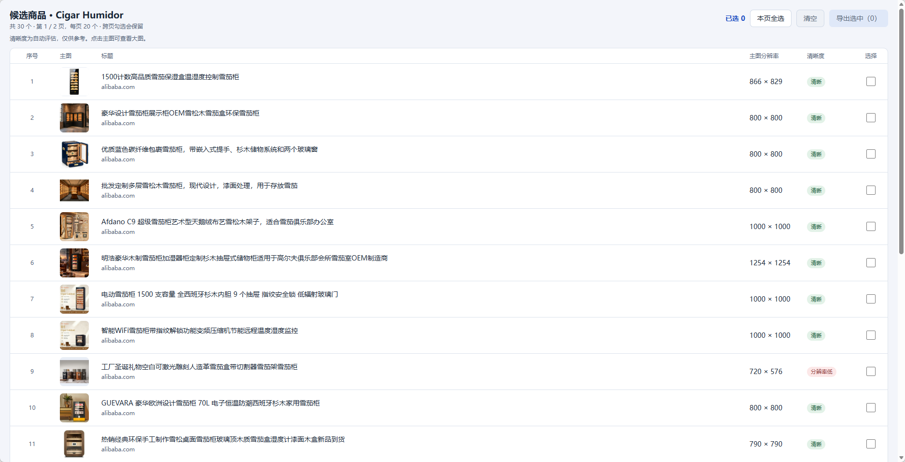
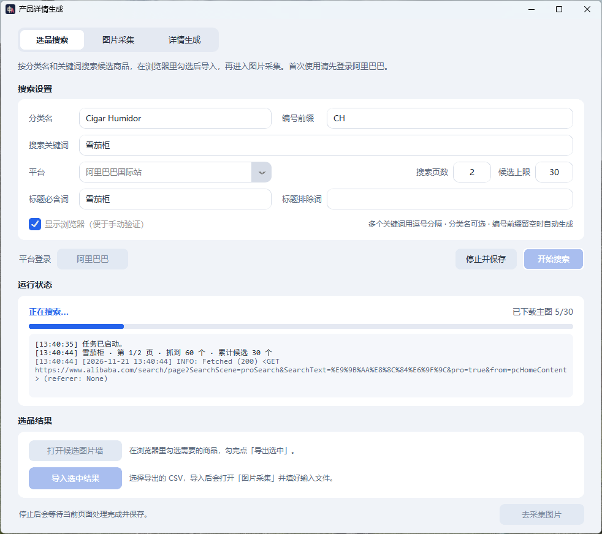
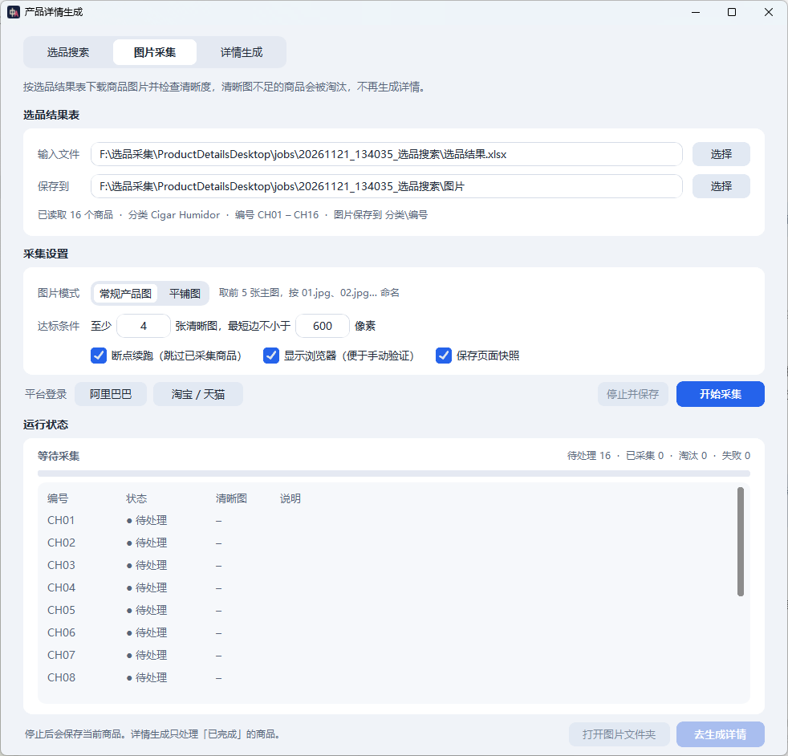
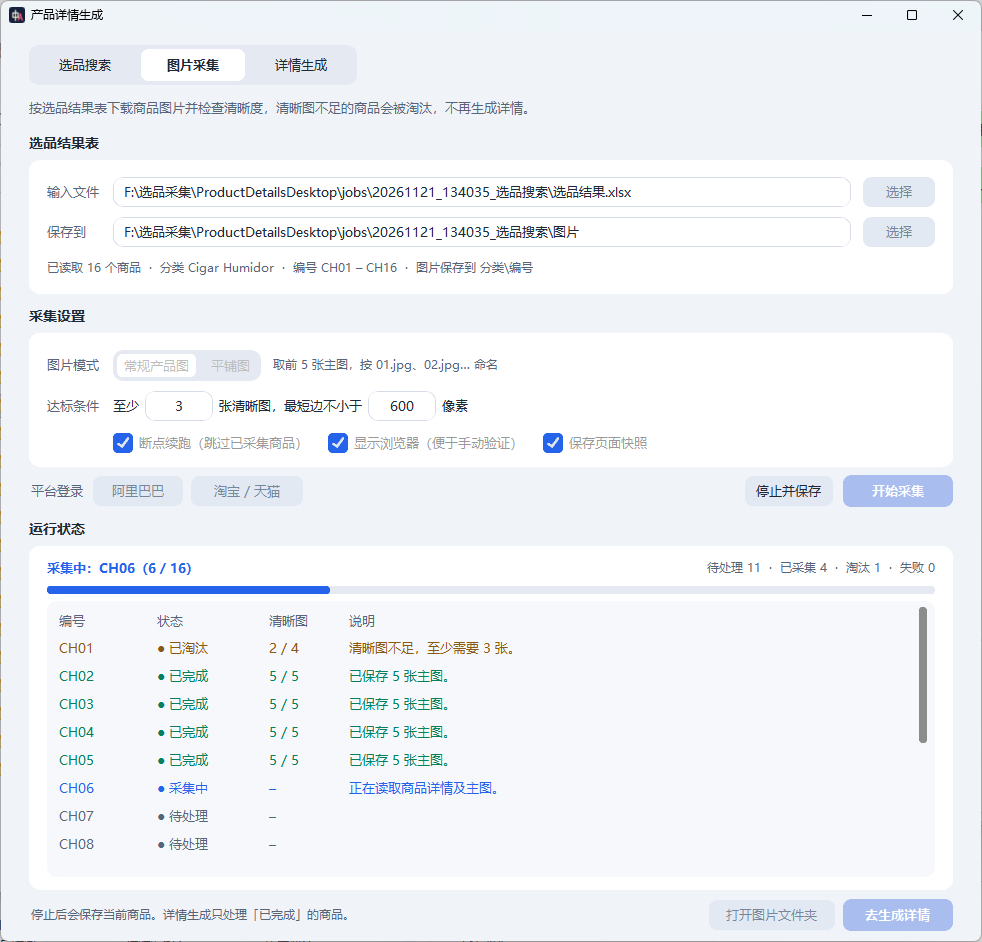
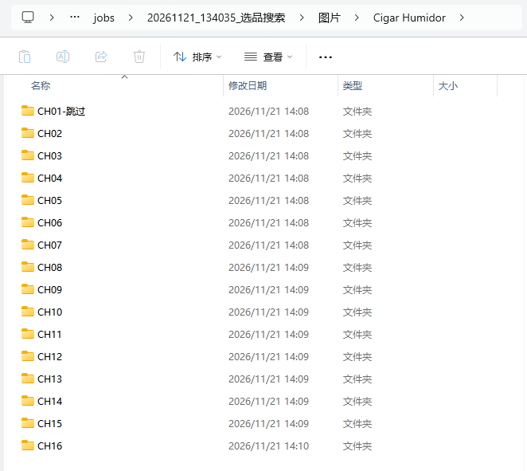
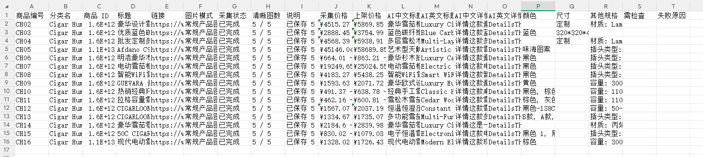
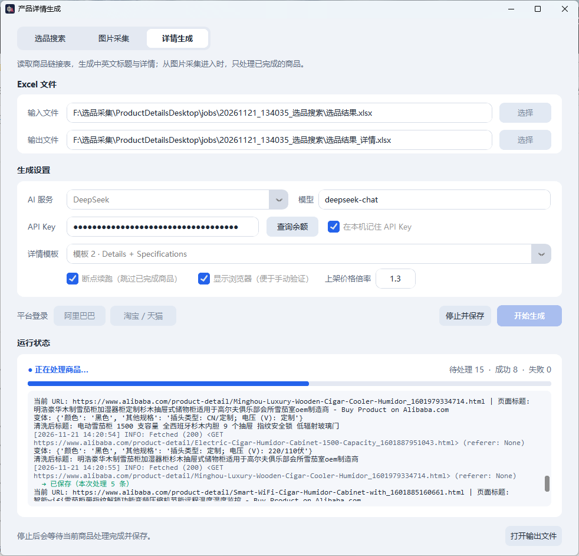

<div align="center">
  
  <h1>Nothiz Product Desk</h1>
  <p>一款 Windows 桌面工具，支持阿里巴巴国际站选品、商品图片采集和中英文详情批量生成。</p>
  <p>
    <strong><a href="https://github.com/NothiZ/Product-Details-Generation-2.0/releases">下载 Windows 版</a></strong><br />
    <a href="#quick-start">快速开始</a>
    · <a href="#workflow">使用流程</a>
    · <a href="#supported-platforms">支持平台</a>
    · <a href="#run-from-source">源码运行</a>
  </p>
  <p><sub>Windows 10 / 11 · 自带 Chromium · 支持 DeepSeek 和 Gemini</sub></p>
</div>

<p align="center">
  <a href="assets/screenshots/search-complete.png"></a>
  <a href="assets/screenshots/image-collection-complete.png"></a>
  <a href="assets/screenshots/details-complete.png"></a>
</p>
<p align="center"><sub>选品搜索 · 图片采集 · 详情生成。点击查看原图。</sub></p>

<a name="quick-start"></a>

## 快速开始

1. 在 [Releases](https://github.com/NothiZ/Product-Details-Generation-2.0/releases) 下载对应版本的 Windows 压缩包。当前构建包名为 `Nothiz Product Desk-win-x64.zip`。
2. 完整解压后运行 `Nothiz Product Desk.exe`，保留同目录的 `_internal`。首次启动时选择数据存放位置。
3. 从阿里巴巴国际站选品时，先在「选品搜索」登录，再按下方流程操作。已有商品链接表时，可直接打开「详情生成」。
4. 生成详情时填写 DeepSeek 或 Gemini API Key，选择模型和模板，然后点击「开始生成」。

发布包自带 Python 运行时、依赖和 Chromium。采集和生成详情需要联网，AI 调用费用按所选服务商的账号计费。更多桌面操作见 [使用说明](DESKTOP_USAGE.txt)。

<a name="workflow"></a>

## 使用流程

下方截图以一个雪茄柜任务为例。该任务找到 **30 个候选**，选中 **16 个商品**，最终有 **15 个商品**通过图片检查并生成详情。

### 1. 选品搜索

- 填写关键词，可设置分类名、编号前缀、搜索页数、候选上限和标题过滤词。达到候选上限或到达最后一页时，程序保存已有候选。
- 搜索结束后点击「打开候选图片墙」。在浏览器查看本地主图和清晰度标签，可以点开大图，也可以跨页勾选。
- 点击「导出选中」下载 CSV，再回到桌面程序点击「导入选中结果」。程序会按当前候选校验商品 ID 和链接、为商品编号，并生成本次任务的 `选品结果.xlsx`。后续流程使用这张任务表。

<p align="center">
  <a href="assets/screenshots/candidate-wall.png"></a>
</p>
<p align="center"><sub>候选图片墙可离线打开，清晰度标签用于辅助人工选品。</sub></p>

<details>
<summary>查看搜索和主图下载进度</summary>

<p align="center">
  <a href="assets/screenshots/search-running.png"></a>
</p>

</details>

### 2. 图片采集

导入后，程序会打开「图片采集」并带入本次任务的选品表。选择图片模式，确认清晰度门槛和保存目录，再点击「开始采集」。

| 图片模式 | 采集范围 | 默认达标条件 |
| --- | --- | --- |
| 常规产品图 | 前 5 张主图 | 至少 4 张清晰图，最短边不小于 600 像素 |
| 平铺图 | 最多 8 张候选图，供人工挑选 | 至少 2 张清晰图，最短边不小于 600 像素 |

程序检查分辨率和清晰度，图片主体仍由人工核对。图片按「分类 / 商品编号」保存，文件名依次为 `01.jpg`、`02.jpg` 等。未达标且已保存图片的商品，其目录会带上 `-跳过`，例如 `CH01-跳过`。

采集状态和清晰图数会写回任务表。更改清晰图张数或最短边后，续跑会按新条件重新判定。改用其他保存位置时，请为本任务选择一个空目录。

<details>
<summary>查看待采集、采集中及图片保存目录</summary>

<p align="center">
  <a href="assets/screenshots/image-collection-ready.png"></a>
  <a href="assets/screenshots/image-collection-running.png"></a>
</p>
<p align="center"><sub>左图为采集前的设置，右图为采集中的逐项结果。</sub></p>

<p align="center">
  <a href="assets/screenshots/image-output-folders.png"></a>
</p>
<p align="center"><sub>图片目录按商品编号排列，未达标且有图片的目录带有「跳过」标记。</sub></p>

</details>

### 3. 详情生成

在图片采集页点击「去生成详情」，程序只处理标记为「已完成」的商品，并沿用任务表里的商品编号。也可以直接导入自己的 `.xlsx` 链接表，首行建议使用列名 `链接`，每行填写一个商品详情页链接。

选择 AI 服务、模型和模板，然后点击「开始生成」。输出默认与输入表位于同一目录，文件名自动加上 `_详情.xlsx`。点击「选择目录」可更改位置。遇到其他任务的同名文件时，程序会提示另选目录。

| 设置或字段 | 说明 |
| --- | --- |
| 详情模板 | 模板 1 使用 Key: Value 列表。模板 2 分为 Details 和 Specifications。 |
| 采集价格与上架价格 | 上架价格默认按采集价格的 **1.25 倍**计算，可调整倍率。价格区间的两端分别计算。 |
| 商品规格与双语文案 | 输出颜色、尺寸、其他规格，以及中英文标题和详情。 |
| 需检查与失败原因 | 需检查列标记命中的指定词，供人工核对。失败原因列记录采集、接口或文案缺失等问题。 |

<p align="center">
  <a href="assets/screenshots/details-excel.png"></a>
</p>
<p align="center"><sub>详情 Excel 保留原商品编号，可按编号找到对应图片。示例中 CH01 未达标，详情表从 CH02 开始。</sub></p>

<details>
<summary>查看详情生成中的界面</summary>

<p align="center">
  <a href="assets/screenshots/details-running.png"></a>
</p>

</details>

<a name="supported-platforms"></a>

## 支持平台

| 平台 | 选品搜索 | 图片采集 | 详情生成 |
| --- | :---: | :---: | :---: |
| Alibaba.com 国际站 | 支持 | 支持 | 支持 |
| 淘宝 | — | — | 支持 |
| 天猫 | — | — | 支持 |

详情生成使用 `alibaba.com`、`taobao.com`、`tmall.com` 或其子域名下的完整商品详情链接。商品规格以页面列出的选项为准，实际库存以平台为准。

淘宝和天猫共用一次登录流程。需要验证码时，保持「显示浏览器」开启，完成验证后回到程序点击「继续」。

## 文件保存在哪里

首次启动选择上级目录后，程序会在其中创建 `ProductDetailsDesktop`。每批选品有自己的任务目录和独立编号。按默认路径，一批完整任务的主要文件如下。

```text
ProductDetailsDesktop/
└─ jobs/
   └─ <任务时间>_选品搜索/
      ├─ candidates.html          候选图片墙
      ├─ candidates/              候选主图
      ├─ 选品结果.xlsx             选品记录和图片采集状态
      ├─ 图片/                    按分类和商品编号保存
      └─ 选品结果_详情.xlsx        生成的双语详情表
```

- **续跑与停止**　详情生成按商品链接复用完整文案。点击「停止并保存」后，程序会完成当前处理并保存已完成的部分。
- **输出表被占用**　最终保存时，程序会尝试写到空闲的 `_backup.xlsx` 或带数字后缀的备份名，并显示实际保存位置。
- **本地设置**　登录状态和设置保存在数据根目录。勾选「在本机记住 API Key」后，密钥会以明文保存到本地 `settings.json`，分享文件时请避开这些数据。生成详情时，商品信息会发送到所选 AI 服务。

## 常见问题

<details>
<summary>为什么搜索结果比设定的页数或候选上限少？</summary>

页数和候选数量都是上限。搜索到最后一页时会保存已找到的候选，标题过滤和商品去重也会影响最终数量。

</details>

<details>
<summary>选品 CSV 导入失败时检查什么？</summary>

请使用当前打开的图片墙导出的 CSV。程序会校验商品 ID 和链接是否出现在当前候选中。确认导入成功后，后续工作只需保留任务目录里的 Excel。

</details>

<details>
<summary>为什么下载包有几百 MB？</summary>

发布包包含 Python 运行时、程序依赖和 Chromium。解压后整套目录可在符合要求的 Windows 电脑上运行。

</details>

<a name="run-from-source"></a>

## 源码运行

推荐使用 Windows 64 位和 Python 3.12。在项目目录打开 PowerShell。

```powershell
python -m venv venv
.\venv\Scripts\python.exe -m pip install -r requirements.txt
$env:PLAYWRIGHT_SKIP_BROWSER_GC = "1"
.\venv\Scripts\python.exe -m patchright install chromium
.\venv\Scripts\python.exe desktop_app.py
```

<details>
<summary>命令行用法</summary>

详情生成可将 [`.env.example`](.env.example) 复制为 `.env` 后填写 API Key，然后在 `run.py` 顶部配置输入表、输出表、服务商和模板。默认输入为 `products.xlsx`，默认输出为 `products_output.xlsx`。

```powershell
.\venv\Scripts\python.exe login.py alibaba
.\venv\Scripts\python.exe run.py
.\venv\Scripts\python.exe image_collection.py --help
```

淘宝或天猫使用 `login.py taobao`。图片采集命令接受任务选品表和图片保存目录，更多选项可通过 `--help` 查看。

</details>

<details>
<summary>Windows 打包和离线测试</summary>

```powershell
.\venv\Scripts\python.exe -m pip install -r requirements-build.txt
.\build_desktop.ps1
.\venv\Scripts\python.exe -B -m unittest discover -s tests -v
```

默认构建到 `dist/`。可用 `-OutputRoot` 另选项目内的构建目录，用 `-SkipZip` 只生成程序目录。回归测试使用本地样本和模拟接口。打包记录见 [开发文档](docs/dev/README.md)。

</details>

## 许可证

项目代码采用 GPL-3.0-only，第三方依赖保留各自的许可条款。详见 [LICENSE](LICENSE)。
