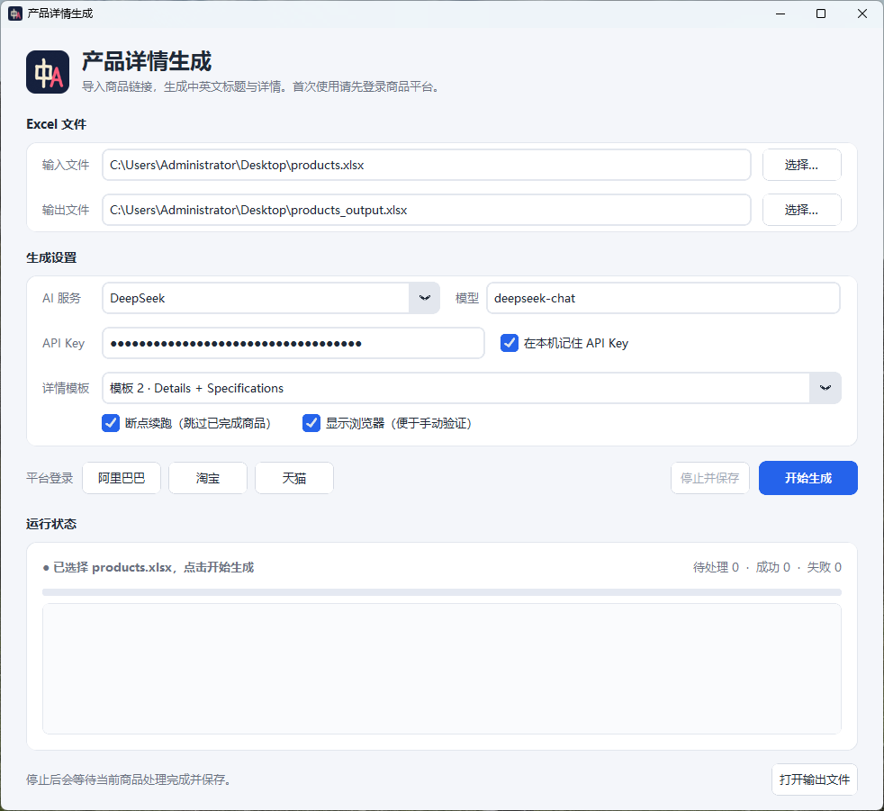

# 产品详情生成 · Product Details Generation

批量采集商品信息，使用 AI 生成中英文标题与详情，并导出为 Excel。提供 Windows 桌面窗口和 Python 命令行入口。

采集层使用 **Scrapling**，窗口使用 **CustomTkinter**，支持 **DeepSeek** 和 **Gemini**。

## 界面预览



## 功能与支持范围

- 从 Excel 读取商品链接，批量采集价格、属性与详情。
- 生成中文标题、英文标题、中文详情和英文详情，提供两种详情模板。
- 采集与 AI 生成异步并行，浏览器会话按平台复用。
- 支持平台登录、可见浏览器、进度日志、断点续跑及停止后保存。


| 平台               | 商品信息采集         | 可选变体采集                 |
| ------------------ | -------------------- | ---------------------------- |
| Alibaba.com 国际站 | 支持                 | 支持颜色、尺寸及其他规格维度 |
| 淘宝               | 支持价格、属性及详情 | 暂不支持                     |
| 天猫               | 支持价格、属性及详情 | 暂不支持                     |

仅接受 `alibaba.com`、`taobao.com`、`tmall.com` 及其子域名下的完整 HTTP / HTTPS 商品链接。1688 和其他域名会被拒绝，批量任务会将对应商品计入失败，不进入浏览器采集或文案生成流程。淘宝与天猫仍然支持，不属于拒绝范围。

商品页面、账号权限和验证流程可能影响采集结果。采集时请遵守平台服务条款和访问限制，仅处理你有权访问和使用的商品页面及数据。

## 下载与使用

Windows 10 / 11，64 位。前往 [GitHub Releases](https://github.com/NothiZ/Product-Details-Generation-2.0/releases) 下载 `ProductDetailsDesktop-win-x64.zip`。

1. **完整解压 ZIP**，打开 `ProductDetailsDesktop.exe`。请保留旁边的 `_internal` 文件夹。
2. 在附带的 `输入模板.xlsx` 中填写商品链接，或选择自己的 `.xlsx` 文件。
3. 确认输出路径。首次选择输入文件时，程序会提供默认输出路径；输出文件会自动生成，无需提前创建。
4. 选择 DeepSeek 或 Gemini，填写自己的 API Key、模型名称及详情模板。
5. 首次使用或登录失效时，点击对应的平台登录按钮，在浏览器完成登录，再回到窗口点击“我已完成登录，继续”。
6. 点击“开始生成”，完成后点击“打开输出文件”。

发布包包含 Python 运行时、依赖库及 Chromium，无需另外安装 Python 或浏览器。采集商品和调用 AI 接口需要联网，API 调用费用由所选服务商按账号计费。

详细操作见 [桌面版使用说明](DESKTOP_USAGE.txt)。

### Windows 安全提示

当前发布的 exe 未进行代码签名，下载或首次启动时可能出现 SmartScreen 信誉提示。请从本仓库 Releases 下载，核对发布版本及提供的文件摘要；出现明确的恶意软件检测时应停止运行并反馈，不要关闭安全防护。相关机制见 [Microsoft SmartScreen 说明](https://learn.microsoft.com/windows/apps/package-and-deploy/smartscreen-reputation)。

## Excel 格式与任务保存

输入表第一行填写列名，每行一个商品链接。推荐使用 `链接`，也支持 `商品链接`、`网址`、`地址`、`URL` 和 `Link`。


| 链接                        |
| --------------------------- |
| 商品详情页的完整 https 链接 |

输出表包含以下结果列：

`价格`、`AI中文标题`、`AI英文标题`、`AI中文详情`、`AI英文详情`、`颜色`、`尺寸`、`其他规格`。

- **断点续跑**：按商品链接复用输出表中已有“AI中文标题”的结果。需要重新采集或生成时，取消勾选断点续跑，并先备份需要保留的输出文件。
- **停止并保存**：停止启动新商品任务，等待正在处理的任务结束后保存。AI 接口响应慢时需要等待。
- **文件占用**：最终保存时若输出表被 Excel 占用，程序会尝试另存为 `_backup.xlsx`，并显示实际保存位置。

输入与输出不能使用同一个文件。生成内容请核对后再使用，尤其是价格、规格及 AI 生成的产品描述。

## 从源码运行

推荐在 Windows 64 位环境使用 **Python 3.12**，当前依赖至少需要 Python 3.11。在 PowerShell 中执行：

```powershell
git clone https://github.com/NothiZ/Product-Details-Generation-2.0.git
cd Product-Details-Generation-2.0
python -m venv venv
.\venv\Scripts\python.exe -m pip install -r requirements.txt
$env:PLAYWRIGHT_SKIP_BROWSER_GC = "1"
.\venv\Scripts\python.exe -m patchright install chromium
.\venv\Scripts\python.exe desktop_app.py
```

桌面窗口中直接填写 API Key 即可。（如需修改代码，关闭窗口并重新运行最后一条命令可查看效果，无需打包。）

`PLAYWRIGHT_SKIP_BROWSER_GC=1` 仅用于浏览器安装阶段，跳过缓存浏览器的自动清理，避免影响同一台电脑上的其他项目；它不是采集功能开关。可省略这行，但建议在多项目共用浏览器缓存时保留。

源码仓库不包含生成后的 `输入模板.xlsx`。自行创建 `.xlsx` 文件，在第一行填写 `链接`、后续每行填写一个商品详情链接即可，无需先运行打包脚本。

### 命令行批量生成

将 `.env.example` 复制为 `.env`，填写所选服务的 API Key：

```powershell
Copy-Item .env.example .env
```

在 `run.py` 顶部设置 `PROVIDER`、`DESC_TEMPLATE`、输入输出文件及并发参数。默认读取 `products.xlsx`，写入 `products_output.xlsx`。

按需登录对应平台，然后运行：

```powershell
.\venv\Scripts\python.exe login.py alibaba
# 淘宝使用 login.py taobao，天猫使用 login.py tmall
.\venv\Scripts\python.exe run.py
```

`DESC_TEMPLATE` 可选 `template1`（Key: Value 列表）或 `template2`（Details + Specifications）。`RESUME = True` 启用断点续跑。

命令行还可在 `.env` 或系统环境变量中配置：


| 变量             | 作用                                    | 程序默认值                     |
| ---------------- | --------------------------------------- | ------------------------------ |
| `DEEPSEEK_MODEL` | DeepSeek 模型名称                       | `deepseek-chat`                |
| `GEMINI_MODEL`   | Gemini 模型名称                         | `gemini-2.5-flash`             |
| `LLM_RPM`        | AI 请求的每分钟限速，`0` 表示不主动限速 | DeepSeek 为`0`，Gemini 为 `10` |

Gemini 的 `10` 次/分钟是本程序的默认限速，不代表服务商向你的账号提供的额度；批量任务会因限速等待。请按账号实际限制调整，不要仅靠提高并发绕过额度。系统中已存在的同名环境变量优先于 `.env`；桌面版的模型以窗口设置为准，`LLM_RPM` 仍可通过环境变量设置。

### 单条商品采集检查

```powershell
.\venv\Scripts\python.exe check_product.py "商品详情页的完整链接"
```

此命令不调用 AI，也不修改批量输出表。结果默认保存至 `debug/product_check.json`，其中 `variant_dimensions` 为变体维度与全部选项，`variants` 为输出表使用的颜色、尺寸及其他规格。添加 `--headless` 可隐藏浏览器；需要手动验证时保持浏览器可见。

## 打包 Windows 程序

在已创建虚拟环境的项目目录中执行：

```powershell
.\venv\Scripts\python.exe -m pip install -r requirements-build.txt
.\build_desktop.ps1 -OutputRoot 'dist\slim-ui'
```

打包结果：

```text
dist/slim-ui/
├── ProductDetailsDesktop/
│   ├── ProductDetailsDesktop.exe
│   ├── _internal/
│   ├── 使用说明.txt
│   └── 输入模板.xlsx
└── ProductDetailsDesktop-win-x64.zip
```

分发 ZIP 或整个程序文件夹。构建配置会收集 CustomTkinter 主题和字体、Patchright 驱动与 Chromium，并排除未使用的 Playwright 驱动资源。省略 `-OutputRoot` 时，默认输出到 `dist`；加 `-SkipZip` 可跳过压缩。

`build_desktop.ps1` 使用 **UTF-8 with BOM** 编码，兼容 Windows PowerShell 5.1；编辑后请保留该编码，避免中文模板生成失败。

## 项目结构


| 文件                                 | 用途                               |
| ------------------------------------ | ---------------------------------- |
| `desktop_app.py`                     | 桌面窗口与交互                     |
| `desktop_runtime.py`                 | 设置、资源路径与后台任务通信       |
| `desktop_worker.py`                  | 后台采集、生成及登录任务           |
| `scraper.py`                         | Scrapling 会话与商品数据提取       |
| `ai_writer.py`                       | 提示词、双语文案生成与清洗         |
| `llm_client.py`                      | DeepSeek / Gemini 调用、限速与重试 |
| `run.py`                             | 批量异步流水线与 Excel 保存        |
| `login.py` / `check_product.py`      | 平台登录与单条采集检查             |
| `desktop.spec` / `build_desktop.ps1` | 打包配置与构建脚本                 |
| `tests/`                             | 回归测试与本地商品样本             |

开发过程文档和历史源码校验快照已集中在 [docs/dev](docs/dev/README.md)，不参与程序运行。

## 与 1.x 的简要对比

1.x 以命令行脚本为主要使用方式；2.0 使用 Scrapling 采集层和可复用的异步浏览器会话，提供桌面窗口及 Windows 分发包。当前版本可在窗口选择两种详情模板、查看进度日志，并执行登录、断点续跑与停止保存。

## 变更记录

### 未发布

- 内容筛选主要交给 prompt，本地保留格式整理、明确属性字段过滤及有效内容校验，减少正常词语误删。
- 修复加粗标签、中文冒号和空内容处理，重复标题使用序号去重。
- 按真实域名校验商品链接，拒绝 1688、未支持域名和伪装平台链接。
- 补充文案、链接及批量失败处理测试，整理开发文档。

已发布程序及对应说明见 [Releases](https://github.com/NothiZ/Product-Details-Generation-2.0/releases)。未发布的源码修改需重新打包后才会包含在 exe 中。

## 测试

```powershell
.\venv\Scripts\python.exe -B -m unittest discover -s tests -v
```

回归测试使用本地样本和模拟接口，不调用真实商品平台或 AI 服务。打包脚本的中文编码测试需要 Windows PowerShell。

## 本地数据与 API Key

桌面版的设置、登录状态及任务日志默认位于 `%LOCALAPPDATA%\ProductDetailsDesktop`；输入输出 Excel 保存在所选位置。命令行登录状态默认保存在项目目录中的 `alibaba_state.json`、`taobao_state.json` 和 `tmall_auth.json`。

勾选“在本机记住 API Key”后，密钥会以明文保存在本地 `settings.json` 中。不要分享包含密钥或登录状态的数据目录。命令行使用的 `.env`、商品表、登录态和构建产物均已加入 `.gitignore`。

生成文案时，采集到的商品信息会发送到你选择的 AI 服务。发布包不包含开发者的 API Key、账号登录态或真实商品表。

## 许可证

本仓库的项目代码按 **GNU General Public License v3.0**（`GPL-3.0-only`）发布，完整条款见 [LICENSE](LICENSE)。第三方依赖及随程序分发的组件保留各自的许可证，项目许可证不替代这些组件的授权条款。
