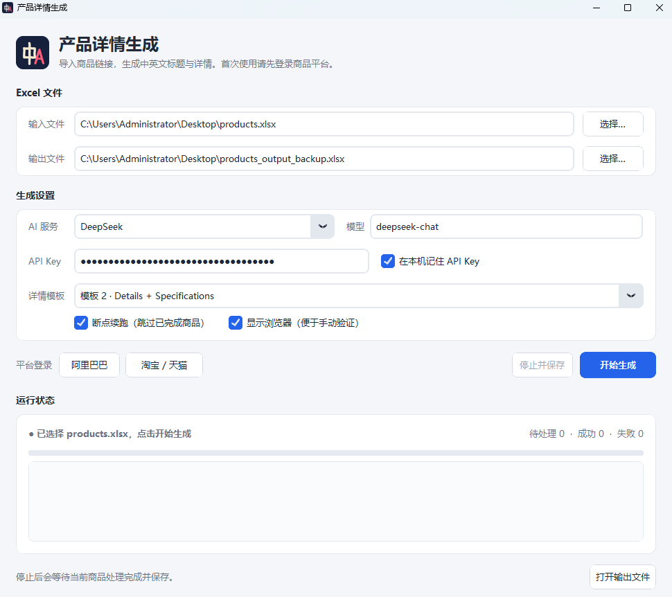

<div align="center">


# 产品详情生成

**Product Details Generation**

从商品链接到中英文标题与详情，一份 Excel 批量完成。

[](https://github.com/NothiZ/Product-Details-Generation-2.0/releases/latest)


[](LICENSE)

**[下载 Windows 版](https://github.com/NothiZ/Product-Details-Generation-2.0/releases/latest)** · [快速开始](#快速开始) · [支持平台](#支持平台) · [源码运行](#源码运行) · [常见问题](#常见问题)

无需安装 Python · 自带 Chromium · 支持 DeepSeek / Gemini

</div>

---

## 界面预览



<p align="center"><sub>选择商品表格，配置 AI 服务，在窗口中查看进度与日志</sub></p>

## 能做什么


| 批量采集                 | 双语生成                 | 窗口操作             |
| :----------------------- | :----------------------- | :------------------- |
| 从 Excel 导入商品链接    | 生成中英文标题与详情     | 平台登录、进度与日志 |
| 提取价格、属性与商品信息 | 两种详情模板可选         | 停止后保存、断点续跑 |
| 采集颜色、尺寸及其他变体 | 标记指定词，方便人工检查 | 自动生成输出 Excel   |

采集层使用 **Scrapling**，窗口使用 **CustomTkinter**。采集与 AI 生成异步并行，浏览器会话按平台复用。

## 快速开始

适用于 **Windows 10 / 11，64 位**。准备自己的 DeepSeek 或 Gemini API Key，并确保电脑能够联网。

前往 **[Releases 下载最新版](https://github.com/NothiZ/Product-Details-Generation-2.0/releases/latest)**，下载 `ProductDetailsDesktop-win-x64.zip`。

1. **完整解压 ZIP**，打开 `ProductDetailsDesktop.exe`。请保留旁边的 `_internal` 文件夹。首次启动时，选择 `ProductDetailsDesktop` 数据文件夹的存放位置。
2. 在附带的 `输入模板.xlsx` 中填写商品链接，或选择自己的 `.xlsx` 文件。
3. 程序默认在输入表所在目录生成「输入表名_详情.xlsx」。可以点击「选择目录」更改保存位置。如果同名输出属于其他输入表，或无法确认归属，请改选保存目录。
4. 选择 DeepSeek 或 Gemini，填写自己的 API Key、模型名称及详情模板。
5. 首次使用或登录失效时，点击“阿里巴巴”或“淘宝 / 天猫”登录，在浏览器完成登录，再回到窗口点击“我已完成登录，继续”。淘宝、天猫共用一次登录流程，程序会在同一浏览器会话中完成天猫登录确认后保存两站状态。
6. 点击“开始生成”，完成后点击“打开输出文件”。

发布包包含 Python 运行时、依赖库及 Chromium，无需另外安装 Python 或浏览器。采集商品和调用 AI 接口需要联网，API 调用费用由所选服务商按账号计费。

详细操作见 [桌面版使用说明](DESKTOP_USAGE.txt)。

> **完整解压后再运行。** EXE 旁边的 `_internal` 是必需的依赖目录，不能只复制 EXE。

## 支持平台


| 平台                   | 商品信息         | 可选变体             |
| :--------------------- | :--------------- | :------------------- |
| **Alibaba.com 国际站** | 价格、属性及详情 | 颜色、尺寸及其他规格 |
| **淘宝**               | 价格、属性及详情 | 颜色、尺寸及其他规格 |
| **天猫**               | 价格、属性及详情 | 颜色、尺寸及其他规格 |

接受 `alibaba.com`、`taobao.com`、`tmall.com` 及其子域名下的完整 HTTP / HTTPS 商品链接。

**不支持 1688、淘口令短链（`m.tb.cn`）、天猫国际（`tmall.hk`）及其他域名。** 请使用支持平台的商品详情页完整链接；不支持的链接会记录失败原因，不进入采集或生成流程。

淘宝、天猫变体优先读取当前商品的页面内嵌 SKU 数据，并以购买面板选项兜底。采集包含未选中和页面列出的售罄选项，**不代表所有组合当前都有库存**；无变体商品的对应列可以为空。

商品页面、账号权限和验证流程可能影响采集结果。请遵守平台服务条款和访问限制，仅处理你有权访问和使用的商品页面及数据。

## Excel 格式与任务保存

输入表第一行填写列名，每行一个商品链接。推荐使用 `链接`，也支持 `商品链接`、`网址`、`地址`、`URL` 和 `Link`。


| 链接                        |
| --------------------------- |
| 商品详情页的完整 https 链接 |

输出表包含以下结果列：


| 内容       | 输出列                             |
| :--------- | :--------------------------------- |
| 商品信息   | `采集价格`、`上架价格`、`颜色`、`尺寸`、`其他规格` |
| 中文文案   | `AI中文标题`、`AI中文详情`         |
| 英文文案   | `AI英文标题`、`AI英文详情`         |
| 检查与处理 | `需检查`、`失败原因`               |

上架价格默认按采集价格的 1.25 倍计算，可在「详情生成」中调整倍率。价格区间的两端分别计算。


| 详情模板   | 结构                                           |
| :--------- | :--------------------------------------------- |
| **模板 1** | Key: Value 列表                                |
| **模板 2** | Details + Specifications，分为详情与规格两部分 |

内容取舍由 prompt 负责，本地保留格式整理及按明确字段名过滤产地、型号等规则。每条商品只进行一次文案生成，不因指定词或空内容自动重写；接口连接异常的重试仍使用原有网络处理机制。

**需检查**：列出文案中命中的指定词，例如 OEM、批发、平台名称和 LOGO。保留原文、正常导出并计入成功，不触发重写，也不影响续跑。可逐条修改，或筛选这一列集中处理；未命中时留空。

**失败原因**：记录链接不支持、采集失败、接口调用失败或必要的中英文标题、详情缺失。失败行会尽量保留已有的部分文案，下次续跑时可补做。完整文案即使命中指定词，也会复用并更新“需检查”。

成功和失败的结果都按原保存间隔落盘。“需检查”只覆盖指定词，不是语义审核结果，最终仍以人工审核为准。

- **断点续跑**：按商品链接复用完整文案，“需检查”不影响复用；真失败或不完整的行会重新处理。需要重新采集或生成所有商品时，取消勾选断点续跑，并先备份需要保留的输出文件。
- **停止并保存**：停止启动新商品任务，等待正在处理的任务结束后保存。AI 接口响应慢时需要等待。
- **文件占用**：最终保存时若输出表被 Excel 占用，程序会尝试另存为 `_backup.xlsx`，并显示实际保存位置。

输入与输出不能使用同一个文件。生成内容请核对后再使用，尤其是价格、规格及 AI 生成的产品描述。

## 常见问题

<details>
<summary><strong>登录后仍然抓不到商品或变体，怎么办？</strong></summary>

检查是否使用支持平台的商品详情页完整链接，并确认登录没有失效。保持“显示浏览器”勾选，按页面提示手动完成验证码或其他验证。

部分商品没有变体，或受账号权限、页面结构及平台访问限制影响，仍可能采集失败。源码用户可以使用下方的单条商品检查命令排查。

</details>

<details>
<summary><strong>为什么 ZIP 有几百 MB？</strong></summary>

发布包包含 Python 运行时、依赖库、Patchright 驱动和 Chromium，因此其他电脑无需安装 Python 或浏览器。打包配置已排除未使用的 Playwright 驱动资源。

</details>

<details>
<summary><strong>Windows 提示程序未签名，怎么办？</strong></summary>

当前 EXE 未进行代码签名，下载或首次启动时可能出现 SmartScreen 信誉提示。请从本仓库 Releases 下载，并确认来源和版本；出现明确的恶意软件检测时，应停止运行并反馈，不要关闭安全防护。

相关机制见 [Microsoft SmartScreen 说明](https://learn.microsoft.com/windows/apps/package-and-deploy/smartscreen-reputation)。

</details>

## 源码运行

推荐在 Windows 64 位环境使用 **Python 3.12**，当前依赖至少需要 Python 3.11。在 PowerShell 中执行：

```powershell
git clone https://github.com/NothiZ/Product-Details-Generation-2.0.git
cd Product-Details-Generation-2.0
python -m venv venv
.\venv\Scripts\python.exe -m pip install -r requirements.txt
$env:PLAYWRIGHT_SKIP_BROWSER_GC = "1"
.\venv\Scripts\python.exe -m patchright install chromium
.\venv\Scripts\python.exe desktop_app.py
```

桌面窗口中直接填写 API Key 即可。（如需修改代码，关闭窗口并重新运行最后一条命令可查看效果，无需打包。）

`PLAYWRIGHT_SKIP_BROWSER_GC=1` 仅用于浏览器安装阶段，跳过缓存浏览器的自动清理，避免影响同一台电脑上的其他项目；它不是采集功能开关。可省略这行，但建议在多项目共用浏览器缓存时保留。

源码仓库不包含生成后的 `输入模板.xlsx`。自行创建 `.xlsx` 文件，在第一行填写 `链接`、后续每行填写一个商品详情链接即可，无需先运行打包脚本。

### 阿里巴巴选品候选表

桌面窗口打开「选品搜索」，登录阿里巴巴后填写关键词，点击「开始搜索」。采集到最后一页时会保存已有候选。生成后点击「打开候选图片墙」，可离线翻页、勾选和查看本地主图。清晰度标签用于人工复核。导出 CSV 后，回到桌面窗口点击「导入选中结果」，程序把商品写到当前任务目录的 `选品结果.xlsx`。每个任务独立编号，同一任务重复导入会跳过已有商品。桌面日志会显示任务表路径。

导入后会打开「图片采集」，填入本次任务的选品表。确认保存目录和清晰度条件后，点击「开始采集」。常规模式检查前 5 张主图，默认至少 4 张清晰图且最短边至少 600 像素。平铺图模式最多保存 8 张供人工挑选的候选图。采集状态和清晰图数写回任务表，「去生成详情」会把该表带到详情生成页，只有「已完成」的行会参与生成。

每份选品表使用自己的图片目录。想改到其他位置时，请为该任务选择空目录。续跑会按新的清晰图张数和最短边要求重新检查。

也可以使用 `python image_collection.py <任务选品表.xlsx> <图片目录>` 运行图片采集。用 `--help` 查看模式、阈值和续跑选项。

<details>
<summary><strong>命令行批量生成与环境变量</strong></summary>

将 `.env.example` 复制为 `.env`，填写所选服务的 API Key：

```powershell
Copy-Item .env.example .env
```

在 `run.py` 顶部设置 `PROVIDER`、`DESC_TEMPLATE`、输入输出文件及并发参数。默认读取 `products.xlsx`，写入 `products_output.xlsx`。

按需登录对应平台，然后运行：

```powershell
.\venv\Scripts\python.exe login.py alibaba
# 淘宝 / 天猫按需使用下面的统一入口
.\venv\Scripts\python.exe login.py taobao
.\venv\Scripts\python.exe run.py
```

`DESC_TEMPLATE` 可选 `template1`（Key: Value 列表）或 `template2`（Details + Specifications），`RESUME = True` 启用断点续跑。

命令行还可在 `.env` 或系统环境变量中配置：


| 变量               | 作用                                    | 程序默认值                     |
| ------------------ | --------------------------------------- | ------------------------------ |
| `DEEPSEEK_API_KEY` | DeepSeek API Key                        | 自行填写                       |
| `GEMINI_API_KEY`   | Gemini API Key                          | 自行填写                       |
| `DEEPSEEK_MODEL`   | DeepSeek 模型名称                       | `deepseek-chat`                |
| `GEMINI_MODEL`     | Gemini 模型名称                         | `gemini-2.5-flash`             |
| `LLM_RPM`          | AI 请求的每分钟限速，`0` 表示不主动限速 | DeepSeek 为`0`，Gemini 为 `10` |

Gemini 的 `10` 次/分钟是本程序的默认限速，不代表服务商向你的账号提供的额度；批量任务会因限速等待。请按账号实际限制调整，不要仅靠提高并发绕过额度。系统中已存在的同名环境变量优先于 `.env`；桌面版的模型以窗口设置为准，`LLM_RPM` 仍可通过环境变量设置。

</details>

<details>
<summary><strong>打包 Windows 程序</strong></summary>

在已创建虚拟环境的项目目录中执行：

```powershell
.\venv\Scripts\python.exe -m pip install -r requirements-build.txt
.\build_desktop.ps1 -OutputRoot 'dist\slim-ui'
```

打包结果：

```text
dist/slim-ui/
├── ProductDetailsDesktop/
│   ├── ProductDetailsDesktop.exe
│   ├── _internal/
│   ├── 使用说明.txt
│   └── 输入模板.xlsx
└── ProductDetailsDesktop-win-x64.zip
```

分发 ZIP 或整个程序文件夹。构建配置会收集 CustomTkinter 主题和字体、Patchright 驱动与 Chromium，并排除未使用的 Playwright 驱动资源。省略 `-OutputRoot` 时，默认输出到 `dist`；加 `-SkipZip` 可跳过压缩。

`build_desktop.ps1` 使用 **UTF-8 with BOM** 编码，兼容 Windows PowerShell 5.1；编辑后请保留该编码，避免中文模板生成失败。

</details>

<details>
<summary><strong>运行回归测试</strong></summary>

```powershell
.\venv\Scripts\python.exe -B -m unittest discover -s tests -v
```

回归测试使用本地样本和模拟接口，不调用真实商品平台或 AI 服务。打包脚本的中文编码测试需要 Windows PowerShell。

</details>

## 项目结构

<details>
<summary><strong>查看主要文件及用途</strong></summary>


| 文件                                 | 用途                               |
| ------------------------------------ | ---------------------------------- |
| `desktop_app.py`                     | 桌面窗口与交互                     |
| `desktop_runtime.py`                 | 设置、资源路径与后台任务通信       |
| `desktop_worker.py`                  | 后台采集、生成及登录任务           |
| `scraper.py`                         | Scrapling 会话与商品数据提取       |
| `ai_writer.py`                       | 提示词、双语文案生成与清洗         |
| `llm_client.py`                      | DeepSeek / Gemini 调用、限速与重试 |
| `run.py`                             | 批量异步流水线与 Excel 保存        |
| `login.py`                          | 平台登录                           |
| `desktop.spec` / `build_desktop.ps1` | 打包配置与构建脚本                 |
| `tests/`                             | 回归测试与本地商品样本             |

开发记录见 [docs/dev](docs/dev/README.md)。

</details>

## 版本更新

### [v2.0.1](https://github.com/NothiZ/Product-Details-Generation-2.0/releases/tag/v2.0.1)

- 补齐淘宝、天猫变体采集，支持内嵌 SKU、购买面板及常见旧版选项列表。
- 合并“淘宝 / 天猫”登录，统一命令行和桌面版的登录态目录。
- 增加“需检查”提示，保留原文供人工编辑；真失败保留原因及可用的部分文案。
- 改进加粗标签、中文冒号、空内容处理和商品域名校验。
- 修复桌面发布包的离线浏览器自检兼容问题。

完整发布包及说明见 [Releases](https://github.com/NothiZ/Product-Details-Generation-2.0/releases)。源码修改需重新打包后，才会包含在 EXE 中。

<details>
<summary><strong>与 1.x 的简要对比</strong></summary>

1.x 以命令行脚本为主要使用方式；2.0 使用 Scrapling 采集层和可复用的异步浏览器会话，提供桌面窗口及 Windows 分发包。当前版本可在窗口选择两种详情模板、查看进度日志，并执行登录、断点续跑与停止保存。

</details>

## 本地数据与 API Key

首次打开桌面窗口时，选择上级目录。比如选择 `D:\工作数据`，程序会在其中创建 `ProductDetailsDesktop`，保存设置、登录状态和各任务的日志、候选图片、离线图片墙及选品结果表。以后启动时会自动使用该目录。详情生成的输入和输出 Excel 由对应任务选择。

桌面窗口和命令行共用数据目录里的 `alibaba_state.json`、`taobao_state.json` 与 `tmall_auth.json`。也可以通过 `PRODUCT_DETAILS_DATA_DIR` 指定数据目录。

勾选“在本机记住 API Key”后，密钥会以明文保存在本地 `settings.json` 中。不要分享包含密钥或登录状态的数据目录。命令行使用的 `.env`、商品表、登录态和构建产物均已加入 `.gitignore`。

生成文案时，采集到的商品信息会发送到你选择的 AI 服务。发布包不包含开发者的 API Key、账号登录态或真实商品表。

## 许可证

本仓库的项目代码按 **GNU General Public License v3.0**（`GPL-3.0-only`）发布，完整条款见 [LICENSE](LICENSE)。第三方依赖及随程序分发的组件保留各自的许可证，项目许可证不替代这些组件的授权条款。
